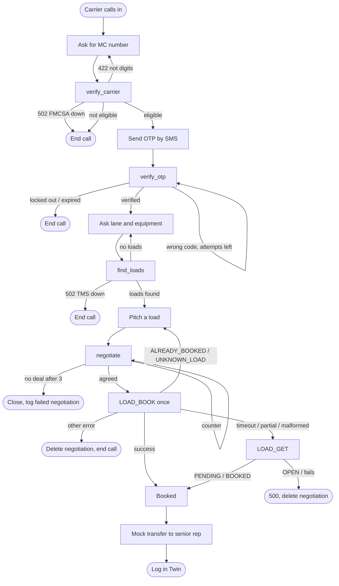

# Edge Cases

All endpoints need the API key (401 otherwise). Bad input → 422 from pydantic.

## Verify Carrier
1. MC number must be digits only (`MC-123`, `12a4`, `""` → 422)
2. FMCSA cases
    1. Allowed to operate → eligible, send OTP
    2. Not allowed / MC not found → not eligible, end call
    3. FMCSA error or timeout → 502, end call
- Open: non-JSON FMCSA reply (500), broker-only MCs pass, mock mode left on in prod

## Verify OTP
1. Code must be exactly 6 digits (422, doesn't use an attempt)
2. Wrong code → attempts remaining; 3 wrong → locked out
3. Expired after 5 min / no code sent → fail
- Open: calling verify_carrier again resets attempts; agent can see the OTP code

## Find Loads
1. Only OPEN loads are returned (LOAD_QUERY also returns booked ones)
2. Top 3 with full details, `max_rate` stripped
3. LOAD_QUERY fails → retry 3x on timeout/partial, then 502
4. LOAD_GET fails for a load → use its search summary instead
- Open: no OTP check, malformed reply ending in END is accepted, no filters → 502

## Negotiate
Problem: the TMS can't tell us which MC booked a load, so 2 carriers booking the same load is out of scope.

1. Max 3 counters, never above `max_rate`, no deal → rejected (no transfer)
2. Cases once a rate is agreed (LOAD_BOOK is sent once, never retried)
    1. Booking succeeds → booked
    2. Booking returns an error → return the error, delete the negotiation
    3. Timeout / partial / malformed → check LOAD_GET
        1. PENDING or BOOKED → booked (no booking ref)
        2. OPEN or LOAD_GET fails → 500, delete the negotiation
- Open: no OTP check, offers of 0 or less accepted, counters reveal `max_rate`

| Booking result | Response |
|---|---|
| Success | 200 booked |
| ALREADY_BOOKED | 409 |
| UNKNOWN_LOAD | 404 |
| INVALID_RATE | 422 |
| Other error | 502 |
| Unknown, LOAD_GET shows booked | 200 booked, no ref |
| Unknown, LOAD_GET shows open / fails | 500 |

## Flow

