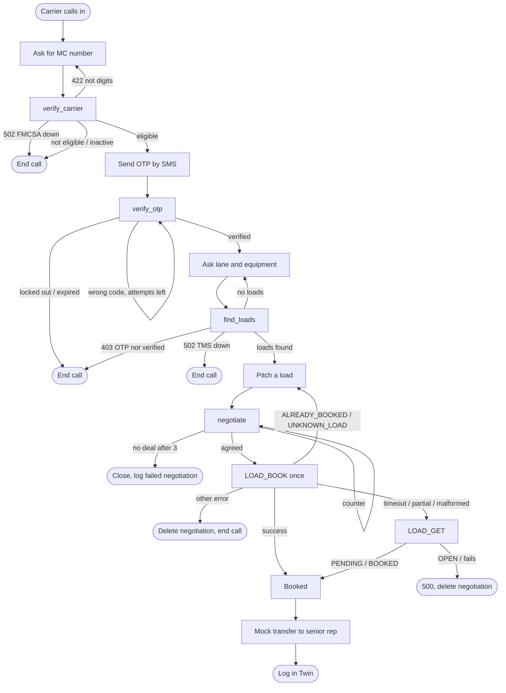

# Edge Cases

All endpoints need the API key (401 otherwise). Bad input → 422 from pydantic.
OTP code is hidden from the agent (confirmed in HappyRobot: it only goes to the email step).
find_loads and negotiate need a verified MC, otherwise 403 `OTP_NOT_VERIFIED`.

## Verify Carrier
1. MC number must be digits only (`MC-123`, `12a4`, `""` → 422)
2. FMCSA cases
    1. Allowed to operate AND USDOT status active (`A`) → eligible, send OTP
    2. Not allowed / USDOT inactive (`I`) / MC not found → not eligible, end call
    3. FMCSA error or timeout → 502, end call
    4. Only FMCSA's real not-found reply (`{"content": [], "retrievalDate": ...}`) means "MC number not found".
       Any other reply without carrier data (null/missing content, non-JSON) → 502 "no usable data", shape logged
        - Seen on 2026-11-06: FMCSA briefly sent Railway empty replies for every MC; it recovered after a redeploy
- Open: broker-only MCs pass, mock mode left on in prod

## Verify OTP
1. Code must be exactly 6 digits (422, doesn't use an attempt)
2. Wrong code → attempts remaining; 3 wrong → locked out
3. Expired after 5 min / no code sent → fail
4. OTP codes are never written to the logs
5. Once verified, the MC stays verified for 2 hours (the rest of the call)
- Open: calling verify_carrier again resets attempts

## Find Loads
1. Only OPEN loads are returned (LOAD_QUERY also returns booked ones)
2. Top 3 with full details, `max_rate` stripped
3. LOAD_QUERY fails → retry 3x on timeout/partial/malformed, then 502
    - If timeout -> Say system is down and end the call
    - If empty results, say nothing is available
4. LOAD_GET fails for a load → don't return it, try the next match instead (max 5 lookups)
    - If LOAD_GET fails for all loads → 502 `LOAD_DETAILS_UNAVAILABLE`, we say our system is down and end the call
5. 200 with no loads only ever means nothing matches; a TMS problem is always a 502
6. Malformed replies are caught even when they end in END: every record must have exactly the expected fields
   (12 for LOAD_QUERY, 19 for LOAD_GET), numeric rates/miles/weight/pieces, 14-digit datetimes and a known EQTYPE.
   Otherwise → `MALFORMED_RESPONSE`, retried like a timeout
    - Example seen on the wire: `C|XXOMMODITY:Produce` (stray `|` splits COMMODITY)
    - Tested live: 51 replies, 50 valid, 1 injected fault caught and retried, 0 valid replies rejected
7. Needs `mc_number`; MC must have passed OTP (403 `OTP_NOT_VERIFIED`)
- Open: no filters → 502

## Negotiate
Problem: the TMS can't tell us which MC booked a load, so 2 carriers booking the same load is out of scope.

1. MC must have passed OTP (403 `OTP_NOT_VERIFIED`)
2. Offer must be greater than 0 (0 or less → 422)
3. Max 3 counters, never above `max_rate`, no deal → rejected (no transfer)
4. Cases once a rate is agreed (LOAD_BOOK is sent once, never retried)
    1. Booking succeeds → booked
    2. Booking returns an error → return the error, delete the negotiation
    3. Timeout / partial / malformed → check LOAD_GET
        1. PENDING or BOOKED → booked (no booking ref)
        2. OPEN or LOAD_GET fails → 500, delete the negotiation
- Open: counters reveal `max_rate`

| Booking result | Response |
|---|---|
| Success | 200 booked |
| ALREADY_BOOKED | 409 |
| UNKNOWN_LOAD | 404 |
| INVALID_RATE | 422 |
| Other error | 502 |
| Unknown, LOAD_GET shows booked | 200 booked, no ref |
| Unknown, LOAD_GET shows open / fails | 500 |

## Flow

